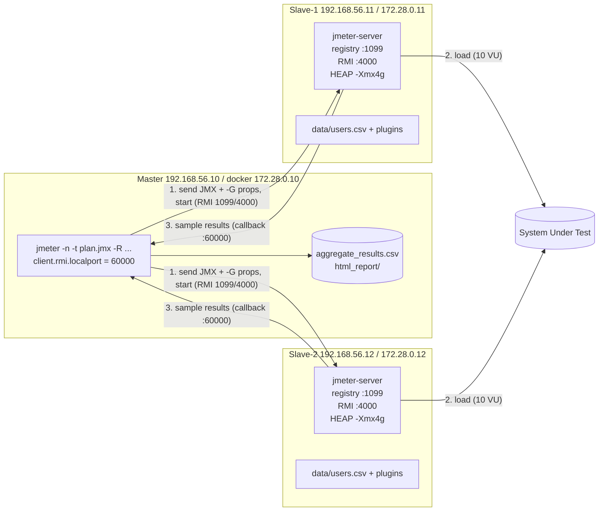

# Level 3 — Distributed (Master–Slave) Testing

**Files:** `level3/L3_Distributed_Dummy.jmx` · `level3/config/distributed.properties` · `level3/scripts/*.sh` · `level3/docker/` (3-node lab)

---

## 1. Why distribute at all?

One JMeter JVM can only generate so much load before **the generator itself** becomes the bottleneck (CPU, heap, sockets, NIC bandwidth). A rough budget per machine: a few hundred to ~1,000 threads for simple HTTP, far fewer with heavy scripting or big responses. Once the generator is saturated, response times go up because *JMeter* is slow, not the system under test (SUT). Distribution spreads threads across machines, and it can also generate load from several network locations.

## 2. Architecture (task item 1)

* **Master (client / controller)**: holds the JMX, sends it to the slaves, triggers start/stop, **receives all sample results** and writes the CSV/HTML. It generates **no** load itself.
* **Slave (server / injector / load generator)**: runs `jmeter-server`, executes the **full** test plan with the **full** thread count, and streams results back to the master.
* **Transport: Java RMI** (Remote Method Invocation). Two connection directions are involved, which is why firewalls bite:
  1. master → slave: RMI registry (`server_port`, 1099) and RMI object port (`server.rmi.localport`, 4000).
  2. slave → master: callbacks carrying sample results (`client.rmi.localport`, 60000 and up).

### Diagram: IPs and ports (task item 2)


ASCII version for slides:
```
                 1099/4000 (RMI)            HTTP(S)
 ┌──────────────┐ ───────────────► ┌─────────────────┐ ─────────► ┌──────────┐
 │ MASTER       │                  │ SLAVE-1 .11     │            │          │
 │ 192.168.56.10│ ◄─────────────── │ jmeter-server   │            │   SUT    │
 │ :60000 (cb)  │   results        └─────────────────┘            │          │
 │              │ ───────────────► ┌─────────────────┐ ─────────► │          │
 │              │ ◄─────────────── │ SLAVE-2 .12     │            └──────────┘
 └──────────────┘   results        └─────────────────┘
```

## 3. Golden rules (memorize)

1. **Every slave runs the whole plan with the whole thread count.** 10 users × 2 slaves = **20** users. Our run showed `Active: 20` exactly. Size per slave = total ÷ number of slaves.
2. **Same JMeter version, same Java major version, same plugins** on all nodes, or you get `ClassNotFoundException` and serialization errors.
3. **The master sends only the JMX.** Anything referenced by path (CSV, certificates, scripts, jars) must already exist on each slave **at the same relative path**.
4. **Properties: use `-G`, not `-J`.** `-J` sets the property on the master only; slaves evaluate `${__P()}` with their own properties. `-Gusers=10` pushes to every slave. (`-Gfile.properties` sends a whole file.)
5. **`java.rmi.server.hostname` must be a reachable IP**, on both sides. RMI embeds this address in the stub it hands to the peer; if it's `127.0.0.1` or a Docker-internal IP the peer can't reach, you get `Connection refused to host: 127.0.0.1`.
6. **Disable RMI SSL in a lab** (`server.rmi.ssl.disable=true`), or generate one keystore with `bin/create-rmi-keystore.sh` and copy `rmi_keystore.jks` to **every** node.
7. **Same network, low latency, synced clocks (NTP)** between master and slaves.
8. **Listeners run on the master.** With `mode=StrippedBatch`, response bodies are stripped before they're sent, so the master's View Results Tree has empty response bodies. We observed this. Keep heavy listeners off in distributed runs.

## 4. Configure a working setup (task item 3)

### Option A: real VMs (UTM / VirtualBox / cloud)
1. Create 3 VMs (Ubuntu 22.04, 2 vCPU, 6 GB RAM) on a **host-only / internal network**: master `192.168.56.10`, slaves `.11`, `.12`.
2. On each: install Java 17 and JMeter 5.6.3 (`tools/install_jmeter.sh /opt` then `ln -s /opt/apache-jmeter-5.6.3 /opt/jmeter`).
3. Open ports: slaves 1099 and 4000 inbound; master 60000–60002 inbound.
   `sudo ufw allow 1099,4000/tcp` (slaves) · `sudo ufw allow 60000:60002/tcp` (master)
4. Copy files from master: `SLAVES="192.168.56.11 192.168.56.12" level3/scripts/distribute_files.sh`
5. Start each slave: `level3/scripts/start_slave.sh 192.168.56.11`
6. Run from the master: `SLAVES=192.168.56.11,192.168.56.12 MASTER_IP=192.168.56.10 level3/scripts/run_distributed.sh`

### Option B: the Docker lab in this repo (used for the recorded run)
Three containers on a private bridge network with **fixed IPs**. They behave like 3 machines.
```bash
cd level3/docker
docker compose build                        # image: Java 17 + JMeter 5.6.3 + plugins + 4 GB heap
docker compose up -d slave1 slave2          # start slaves (172.28.0.11 / .12)
docker compose logs slave1 | tail -3        # "Created remote object ... 172.28.0.11:4000"
docker compose run --rm master              # master 172.28.0.10 runs scripts/run_distributed.sh
docker compose down
```

## 5. Command used to start the test (task item 4)

```bash
jmeter -n \
  -t L3_Distributed_Dummy.jmx \
  -R 172.28.0.11,172.28.0.12 \                 # explicit slave list (-r = all from remote_hosts)
  -q config/distributed.properties \           # ports, ssl off, mode
  -Djava.rmi.server.hostname=172.28.0.10 \     # master's reachable IP for callbacks
  -Gusers=10 -Grampup=30 -Gsteps=5 -Ghold=60 \ # pushed to every slave
  -Gusers.csv=data/users.csv \
  -Glogout.file="results/logout_users_{host}.csv" \
  -l results/dist_<ts>/aggregate_results.csv \
  -e -o results/dist_<ts>/html_report
  # add -X to make the slaves exit when the test ends (EXIT_SLAVES=1 in the script)
```
GUI equivalent: *Run ▸ Remote Start ▸ 172.28.0.11* or *Remote Start All*.

## 6. Files shared across machines (task item 5)

| File | Sent automatically by master? | How it gets to slaves |
|---|---|---|
| `L3_Distributed_Dummy.jmx` | ✅ yes (serialized over RMI) | — |
| `data/users.csv` (CSV Data Set) | ❌ | `distribute_files.sh` / shared volume; same relative path |
| Plugin jars (`jmeter-plugins-casutg`, `-dummy`, `-cmn-jmeter`, `-manager`) | ❌ | copy to `lib/ext` (and `lib`) |
| `config/distributed.properties` | ❌ | copy; loaded with `-q` |
| `bin/setenv.sh` (heap) | ❌ | copy |
| `rmi_keystore.jks` (only if SSL on) | ❌ | copy the **same** file everywhere |
| Results / logout CSVs | — | results come to the master; files written by scripts (logout CSV) stay **on each slave** → hence `{host}` in the name |

> CSV data in distributed mode: each slave reads its **own** copy from row 1. If every user must be unique across slaves, give each slave a different file (e.g. `users_slave1.csv`) using the same file name on each machine.

## 7. Initialize a slave manually (task item 6) and with a script (bonus)

Manual:
```bash
export HEAP="-Xms1g -Xmx4g -XX:MaxMetaspaceSize=256m"
cd ~/level3
$JMETER_HOME/bin/jmeter-server \
    -Djava.rmi.server.hostname=192.168.56.11 \
    -Jserver.rmi.ssl.disable=true \
    -Jserver.rmi.localport=4000
# expected: "Created remote object: UnicastServerRef2 [liveRef: [endpoint:[192.168.56.11:4000](local)..."
```
Script: `scripts/start_slave.sh [IP]` does the same, plus:
* auto-detects the IP, sets the 4 GB heap, refuses to start twice,
* runs in the background with `nohup`, saves the PID,
* waits until port 1099 is listening, so you know the slave is ready.

> `jmeter-server` is only a wrapper for `jmeter -s -Dserver_port=1099 -j jmeter-server.log`. The scripts call `jmeter -s` directly so each node can choose its own log file. Passing `-j` to `jmeter-server` fails with *"Duplicate options for -j"*; we hit this while building the lab.

## 8. Run the Level 2 plan across machines (task item 7)

`L3_Distributed_Dummy.jmx` is the **Level 2 journey** (CSV → Register → Login → Get Profile + email assertion → Random Logout/Delete → logout CSV → VRT) with HTTP samplers replaced by **Dummy Samplers** (tip 2):
* Each Dummy Sampler returns a realistic JSON body and status code (200/201/204) and a random response time (`${__Random(150,450)}`), so **extractors and assertions still execute**. That proves the logic is distributed correctly without hammering a public API.

## 9. Adjust heap memory (task item 8)

Three equivalent ways, in order of preference:
```bash
# 1) bin/setenv.sh (sourced automatically by bin/jmeter); this repo's scripts/setenv.sh
export HEAP=${HEAP:-"-Xms1g -Xmx4g -XX:MaxMetaspaceSize=256m"}
# 2) environment variable for one run
HEAP="-Xms1g -Xmx4g" jmeter-server ...
# 3) edit bin/jmeter: the line  : "${HEAP:="-Xms1g -Xmx1g -XX:MaxMetaspaceSize=256m"}"   (Windows: jmeter.bat set HEAP=...)
```
Verify: `ps -o args -C java | grep -o "Xmx[0-9a-z]*"` → `Xmx4g` (checked inside both slave containers).  
Sizing: Xmx ≤ about 75% of RAM. On a dedicated injector set Xms = Xmx. Watch GC: if `jmeter-gc.log` shows frequent full GCs, add heap or reduce listeners/response storage.

## 10. Aggregate results (task item 9)

`results/dist_<ts>/aggregate_results.csv` (all slaves merged on the master; `threadName` shows the origin like `172.28.0.11-CTG ... 1-3`) + `html_report/index.html` + `summary_metrics.md`.

## 11. Kill JMeter / Java on slaves (task item 10)

Escalation ladder:
| Step | Command | Effect |
|---|---|---|
| Graceful (non-GUI master) | `$JMETER_HOME/bin/stoptest.sh` (UDP 4445) | Threads finish their current sample, then stop |
| Immediate | `$JMETER_HOME/bin/shutdown.sh` | Stop now |
| From master | `-X` flag, or GUI *Remote Exit All* | Slaves exit after the test |
| Process kill | `pkill -f '[A]pacheJMeter.jar'` → `kill -9` if still alive | Hard stop |

Script: `scripts/kill_jmeter.sh local` (on a slave) or `SLAVES="..." scripts/kill_jmeter.sh remote` (over SSH, from master). Docker: `docker exec jmeter-slave1 /work/scripts/kill_jmeter.sh local`.

> **Self-match pitfall (hit and fixed here):** `pgrep -f 'ApacheJMeter.jar'` inside a `bash -c "..."` also matches **the bash process itself**, because its own command line contains that text, so the script kills itself. The `[A]pacheJMeter.jar` regex still matches the java process but not the literal `[A]pache…` text in the script.

## 12. Troubleshooting table (things that actually went wrong)

| Symptom | Cause | Fix |
|---|---|---|
| `FileNotFoundException: rmi_keystore.jks` | SSL is on by default and no keystore | `server.rmi.ssl.disable=true` on **all** nodes (or create a keystore) |
| `Duplicate options for -j` | `jmeter-server` already passes `-j` | use `jmeter -s ... -j mylog.log` |
| `Connection refused to host: 127.0.0.1` | hostname resolves to loopback | `-Djava.rmi.server.hostname=<real IP>` |
| Master hangs at "Waiting for results" | callback port blocked by firewall | fix `client.rmi.localport`, open 60000–60002 |
| `ClassNotFoundException ...ConcurrencyThreadGroup` on slave | plugin missing on slave | copy jars, same versions |
| `users.csv not found` on slave | CSV not copied / wrong relative path | `distribute_files.sh`; start the slave from the folder that contains `data/` |
| 2× expected load | forgot threads are per slave | threads = total / slaves |
