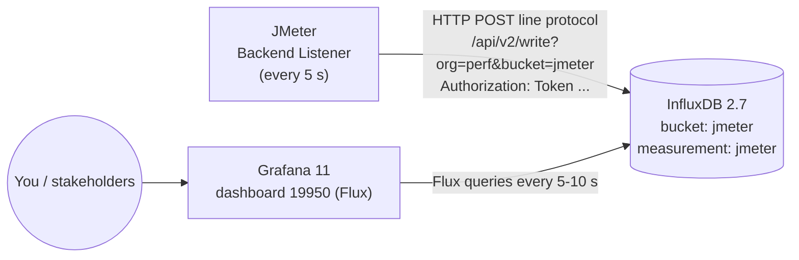

# Level 4 — Live Monitoring with InfluxDB + Grafana

**Files:** `level4/docker-compose.yml` · `level4/grafana/provisioning/**` · `level4/grafana/dashboards/jmeter-19950.json` · `level4/L4_Monitoring_Dummy.jmx` · `level4/run_level4.sh`

---

## 1. The pipeline



* **Backend Listener**: an asynchronous listener. Samples go into a queue (`QUEUE_SIZE` 5000), and every `backend_influxdb.send_interval` seconds (default 5) the client aggregates them per transaction (count, avg, min, max, percentiles, errors, active threads) and sends **aggregated points**, not every sample. That's why it's cheap enough for load tests, unlike View Results Tree.
* **InfluxDB**: a time-series DB optimized for exactly this kind of "metric at timestamp" data.
* **Grafana**: queries InfluxDB and draws panels that auto-refresh.

### Why InfluxDB **2.x**?
Dashboard **19950** ("JMeter Consolidated Dashboard, InfluxDB 2.x using Flux") is written in **Flux**, the InfluxDB 2 query language. The older popular dashboard **5496** uses InfluxQL on InfluxDB 1.x. Picking the wrong DB version is the #1 reason imported dashboards show "No data". I checked the dashboard's queries before choosing the image.

## 2. Step 1: Docker Compose (task item 1)

`level4/docker-compose.yml` (key parts):
```yaml
influxdb:
  image: influxdb:2.7
  ports: ["8086:8086"]
  environment:
    DOCKER_INFLUXDB_INIT_MODE: setup          # auto-onboarding on first start
    DOCKER_INFLUXDB_INIT_ORG: perf
    DOCKER_INFLUXDB_INIT_BUCKET: jmeter
    DOCKER_INFLUXDB_INIT_ADMIN_TOKEN: jmeter-local-dev-token
  volumes: [influxdb-data:/var/lib/influxdb2]   # data survives restarts
grafana:
  image: grafana/grafana:11.2.0
  ports: ["3000:3000"]
  volumes:
    - ./grafana/provisioning:/etc/grafana/provisioning:ro   # datasource + dashboard provider
    - ./grafana/dashboards:/var/lib/grafana/dashboards:ro    # dashboard 19950 JSON
  depends_on: { influxdb: { condition: service_healthy } }
```
```bash
cd level4
docker compose up -d
curl -s localhost:8086/health        # {"status":"pass"}
open http://localhost:3000           # admin / admin (anonymous viewing is enabled too)
```

## 3. Step 2: Add InfluxDB as a Grafana data source (tip 2)

**Provisioned automatically** by `grafana/provisioning/datasources/influxdb.yml`:
```yaml
- name: InfluxDB-JMeter
  uid: influxdb-jmeter
  type: influxdb
  url: http://influxdb:8086        # compose service name, NOT localhost (localhost = the grafana container)
  jsonData: { version: Flux, organization: perf, defaultBucket: jmeter }
  secureJsonData: { token: jmeter-local-dev-token }
```
Manual UI equivalent (for the demo): *Connections ▸ Data sources ▸ Add ▸ InfluxDB* → Query language **Flux** → URL `http://influxdb:8086` → Organization `perf` → Token → Default bucket `jmeter` → **Save & test** shows "datasource is working. 3 buckets found".

## 4. Step 3: Backend Listener in JMeter (task item 2)

*Add ▸ Listener ▸ Backend Listener* → implementation `org.apache.jmeter.visualizers.backend.influxdb.InfluxdbBackendListenerClient`

| Parameter | Value | Notes |
|---|---|---|
| influxdbMetricsSender | `...influxdb.HttpMetricsSender` | |
| **influxdbUrl** | `http://localhost:8086/api/v2/write?org=perf&bucket=jmeter` | v2 endpoint. (v1 would be `/write?db=jmeter`) |
| **influxdbToken** | `jmeter-local-dev-token` | v2 auth header `Authorization: Token …` |
| application | `reqres-dummy` | becomes the `application` tag → dashboard dropdown |
| measurement | `jmeter` | dashboard 19950 queries `_measurement == "jmeter"` |
| summaryOnly | `false` | `true` = only the "all" totals, no per-transaction series |
| samplersRegex | `.*` | which sample labels to send |
| **percentiles** | `50;90;95;99` | creates fields `pct50.0`, `pct90.0`, `pct95.0`, `pct99.0` that the dashboard reads |
| testTitle / eventTags | free text | written as annotations (Test Started / Ended) |

Everything is parameterised with `${__P(...)}`, so the same JMX works against any InfluxDB: `-Jinflux.url=... -Jinflux.token=...`.  
In distributed mode, the Backend Listener runs **on each slave**, and each slave pushes its own metrics directly to InfluxDB. Add the `${__machineName}` to `application` or `eventTags` if you want to split by injector.

### What gets written (InfluxDB line protocol)
```
jmeter,application=reqres-dummy,transaction=TX01\ Register,statut=ok count=12,avg=301.2,min=158,max=453,pct90.0=420,pct95.0=451 ...
jmeter,application=reqres-dummy,transaction=all,statut=all count=48,countError=0,hit=48,rb=..,sb=..
jmeter,application=reqres-dummy,transaction=internal minAT=10,maxAT=10,meanAT=10,startedT=10,endedT=0
```
`statut` (French, kept for historical reasons) = ok / ko / all. `transaction=internal` carries the **active-thread** stats.

## 5. Step 4: Dashboard 19950 (task item 3)

**Provisioned automatically** from `grafana/dashboards/jmeter-19950.json`. To set this up yourself:
1. Download it: `curl -L https://grafana.com/api/dashboards/19950/revisions/latest/download -o jmeter-19950.json`.
2. The downloaded JSON has placeholders `${DS_INFLUXDB}` (80×) and `${VAR_SEND_INTERVAL}` (5×) that the UI import wizard normally asks you for. For file provisioning, replace them with the datasource uid `influxdb-jmeter` and `5` (matching JMeter's 5 s send interval).
3. Set the `bucket` variable default to `jmeter` (otherwise the system bucket `_monitoring` can be selected first and every panel shows "No data").

Manual UI alternative: *Dashboards ▸ New ▸ Import ▸ ID `19950` ▸ Load* → choose the InfluxDB data source, send_interval `5` → Import → choose bucket `jmeter`, application `reqres-dummy`.

Panels required by the task and where to find them in 19950:
| Requirement | Panel |
|---|---|
| Response time | *Over Time ▸ Transactions Response Times* (+ *Metrics* table) |
| Throughput | *Throughput ▸ Total Throughput / Hits per Second / Transactions per Second* |
| Error rate | *Summary ▸ Failure Rate %*, *Errors By Status Codes*, *Error Details* |
| Active threads | *Summary ▸ Active Users* + *Over Time ▸ Active Threads Over Time* |
| Total vs Failed requests over time | *Over Time ▸ Total vs Failed Requests Over Time* |
| Response time (Avg, 90%, 95%) | *Throughput ▸ Response time (Average, 90%, 95%)* |

## 6. Step 5: Run the dummy plan with monitoring (task item 5)

```bash
cd level4 && ./run_level4.sh            # starts stack, waits for health, runs JMeter with the listener
open "http://localhost:3000/d/jmeter-19950?var-bucket=jmeter&var-application=reqres-dummy&from=now-15m&to=now&refresh=5s"
```
During our run, the dashboard showed the Concurrency TG's **5-step ramp to 10 threads**, ~4–5 req/s, 0 failed requests, and per-transaction response times (Register ~300 ms, Login ~350 ms, Journey ~1 s), all updating every 5–10 s.

## 7. Why this matters: live performance monitoring (task item 4)

| Without live monitoring | With JMeter → InfluxDB → Grafana |
|---|---|
| You see results **after** the test (HTML report) | You see degradation **as it happens** and can stop a doomed 2-hour soak after 10 minutes |
| One person reads a CSV | The whole team (devs, ops, managers) watches the same URL |
| Hard to correlate with server metrics | Put JMeter panels next to server CPU/DB/GC (Telegraf / Prometheus) on the **same time axis**: "P95 jumped at 14:32, exactly when DB CPU hit 100%" |
| Each run is isolated | InfluxDB keeps history, so you can compare today's run with last release's run (regression trending) |
| Distributed runs: results only at the end on the master | Each slave pushes directly, so you get a live merged view of all injectors |
| Manual SLA checking | Grafana **alerts** (e.g. error rate > 1% for 1 min → Slack) |

Caveats to mention: the Backend Listener sends **aggregates per interval**, so percentiles in Grafana are per-5-s window. They're not mathematically identical to whole-test percentiles in the HTML report (which uses every sample). Use Grafana for *trend and live detection* and the HTML/CSV for the *final verdict*.
